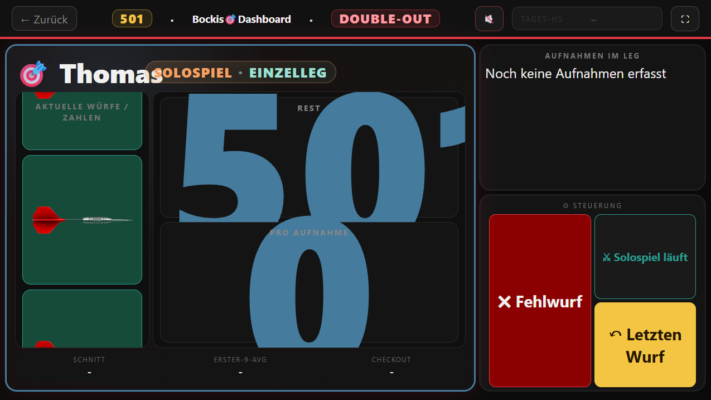

# Löwen Dart Dashboard

Live-Dart-Dashboard für elektronische Löwen-Dartboards. Das System liest Würfe über einen Arduino ein, verwaltet Spiele und Statistiken und stellt optimierte Ansichten für Browser, Controller und Fire TV bereit.

## Live-Ansicht

[](http://localhost:3100/panels/live-spielstand.html)

> Ein Klick auf das Bild öffnet die lokale Live-Ansicht, sobald das Dashboard läuft.

## Funktionen

- Live-Spielstand für X01, Cricket und Elimination
- Automatische Wurferkennung über Arduino und Dart-Matrix
- Controller für Fehlwürfe, Korrekturen, Spielerwechsel und Undo
- Spieler-, Highscore- und Statistikverwaltung
- Persistente Spiel- und Duellstatistiken
- Eigene Fire-TV-Oberfläche für die Anzeige am Dartboard
- Admin-Bereich mit System-, Backup- und Arduino-Status
- REST-APIs für Live-Daten, Spieler, Highscores und Hardwarestatus

## Schnellstart mit Docker

Voraussetzungen: Docker mit Compose-Unterstützung und unter Linux Zugriff auf den Arduino unter `/dev/serial/by-id/`.

```bash
git clone https://github.com/ReXx09/dart-dashboard.git
cd dart-dashboard
cp .env.example .env
docker compose -f docker-compose.yml -f docker-compose.build.yml up -d --build
```

Anschließend ist das Dashboard unter <http://localhost:3100> erreichbar.

Auf Debian oder Raspberry Pi steht zusätzlich der geführte Assistent zur Verfügung:

```bash
chmod +x install.sh menu.sh
./install.sh quickstart
```

Der im Repository eingetragene Gerätepfad in `docker-compose.yml` muss zum eigenen Arduino passen. Den verfügbaren Pfad zeigt beispielsweise dieser Befehl:

```bash
ls -l /dev/serial/by-id/
```

## Lokale Entwicklung

Voraussetzung ist Node.js 20 oder neuer.

```bash
npm install
npm run dev
```

Für den normalen Start ohne automatischen Neustart:

```bash
npm start
```

Das Dashboard funktioniert auch ohne angeschlossenen Arduino. In diesem Fall wird der Hardwarestatus als getrennt angezeigt und die Oberfläche kann weiterhin getestet werden.

## Oberflächen

| Bereich | URL |
| --- | --- |
| Admin-Dashboard | <http://localhost:3100/> |
| Live-Spielstand | <http://localhost:3100/panels/live-spielstand.html> |
| Controller | <http://localhost:3100/panels/controller.html> |
| Spieler | <http://localhost:3100/panels/spieler.html> |
| Highscores | <http://localhost:3100/panels/highscores.html> |
| Statistiken | <http://localhost:3100/panels/statistics.html> |
| Fire-TV-Dashboard | <http://localhost:3200/panels/firetv-dashboard.html> |

Für andere Geräte im Heimnetz wird `localhost` durch die IP-Adresse des Dashboard-Servers ersetzt, zum Beispiel `http://192.168.8.111:3100`.

## Konfiguration

Die Beispielkonfiguration liegt in `.env.example`. Vor dem Docker-Start wird sie nach `.env` kopiert und angepasst.

Wichtige Einstellungen:

| Variable | Bedeutung | Standard |
| --- | --- | --- |
| `SERVER_IP` | LAN-Adresse des Servers | automatische Erkennung |
| `DATA_PATH` | Verzeichnis für persistente Daten | `./data` |
| `ADMIN_PIN_HASH` | Scrypt-Hash der Admin-PIN | nicht gesetzt |
| `ADMIN_SESSION_TTL_MS` | Gültigkeit einer Admin-Sitzung | `900000` |
| `BACKUP_USB_PATH` | optionales USB-Backupziel | nicht gesetzt |
| `NEXTCLOUD_WEBDAV_URL` | optionales Nextcloud-Backupziel | nicht gesetzt |

Eine Admin-PIN kann über den Assistenten erzeugt werden:

```bash
./install.sh pin-hash
```

Passwörter, PINs und Zugangsdaten gehören nur in die lokale `.env` und nicht in Git.

## Daten und Backups

Persistente Dateien liegen standardmäßig im Ordner `data/`. Docker bindet diesen Ordner als Volume nach `/app/data` ein. Vor Updates oder größeren Änderungen sollte der Ordner gesichert werden.

Der Installationsassistent bietet Status-, Diagnose- und Backupfunktionen:

```bash
./install.sh status
./install.sh health
./install.sh logs
```

## Tests

```bash
npm test
```

Nur die Checkout-Tests lassen sich separat ausführen:

```bash
npm run test:checkout
```

## Projektstruktur

```text
dart-dashboard/
|-- public/          Browser-, Controller- und Fire-TV-Oberflächen
|-- modes/           Spiellogik für X01, Cricket und Elimination
|-- lib/             Statistik- und Live-Datenmodule
|-- test/            automatisierte Node.js-Tests
|-- data/            persistente Einstellungen und Spieldaten
|-- server.js        Express-Server, APIs und Arduino-Anbindung
|-- db.js            Datenbankzugriff
`-- docker-compose.yml
```

## Lizenz

Für dieses Projekt ist derzeit keine separate Lizenzdatei hinterlegt.